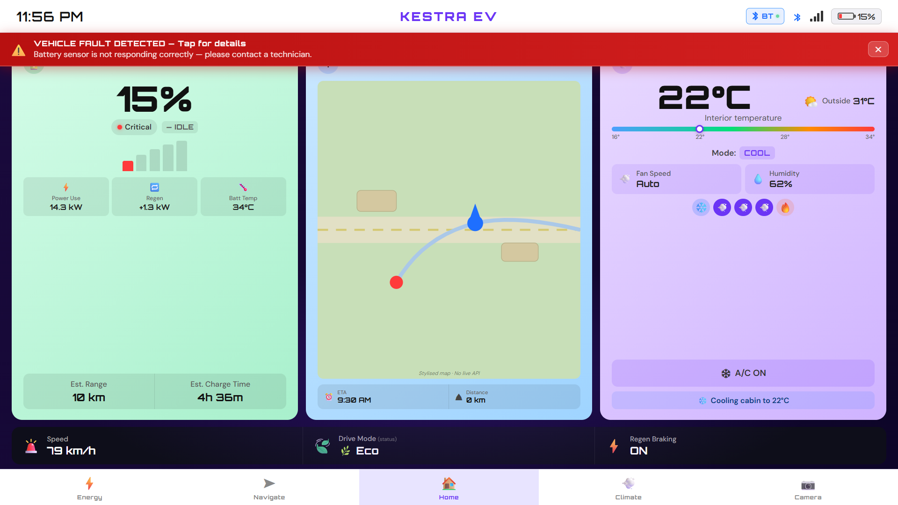
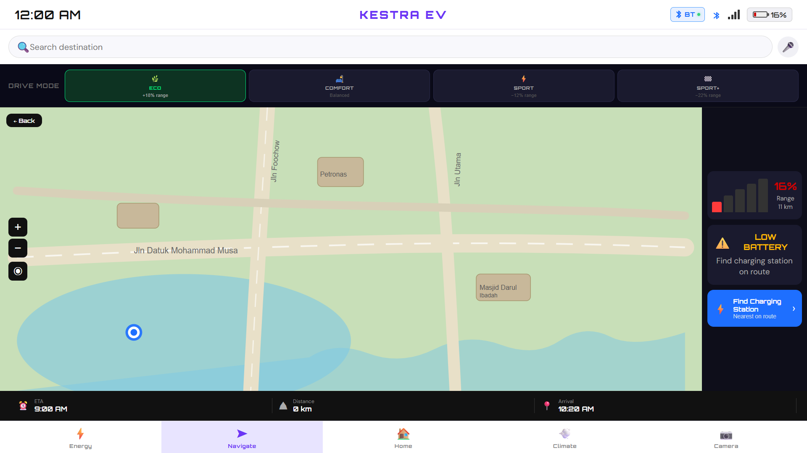
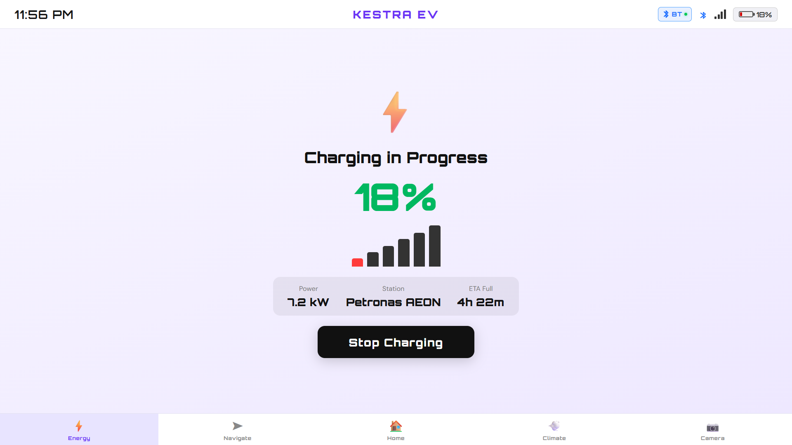
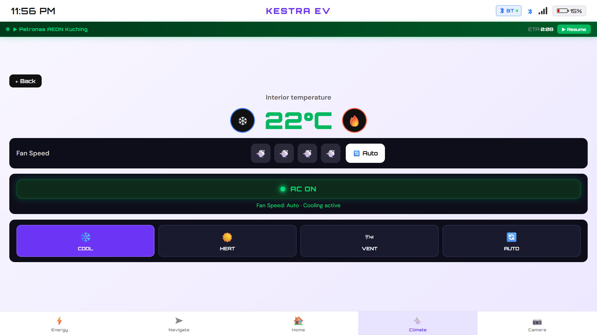
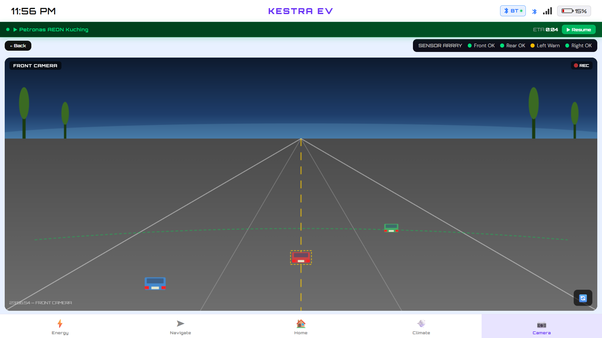

# KESTRA EV Dashboard

An interactive in-vehicle infotainment dashboard prototype for a fictional EV brand, built as a group project with plain HTML, CSS and JavaScript. There are no frameworks or build steps, and everything lives in a single `index.html` file.

## Screenshots

### Home

### Navigation

### Charging

### Climate

### Camera

## Features
- **Home, Climate, Navigation, Energy, Camera and Driving screens** with tab navigation
- **Climate control:** temperature, fan speed, AC toggle and drive modes, with an undo option
- **Navigation:** destination search with suggestions, trip start, live trip countdown and arrival handling
- **Charging and energy:** simulated charging session with battery level updates shown across screens
- **Camera:** dedicated camera view screen
- **Alerts:** warning modals, such as a battery sensor notice and a service contact flow
- **Connectivity:** Bluetooth device list on the home screen

## Tech stack
- HTML5
- CSS3
- Vanilla JavaScript
- Google Fonts (Orbitron, DM Sans)

## How to run
1. Download `index.html` (or clone the repo).
2. Open `index.html` in any modern browser.

No installation is needed. An internet connection is only used to load the fonts.

## Team
Group project developed by a team of 9 students.

### My contributions
- Built the climate screen: temperature, fan and AC controls
- Implemented navigation search and the trip countdown
- Styled the UI and designed the layout

## Notes
This is a front-end prototype. All data (battery level, trips, charging, destinations) is simulated and nothing connects to a real vehicle.
